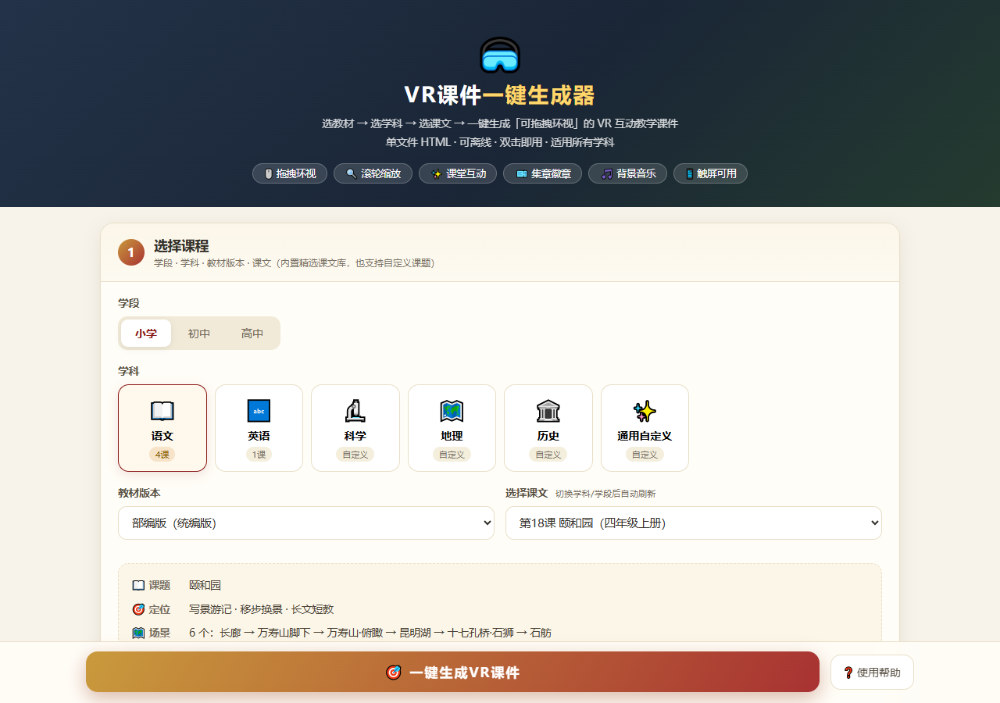
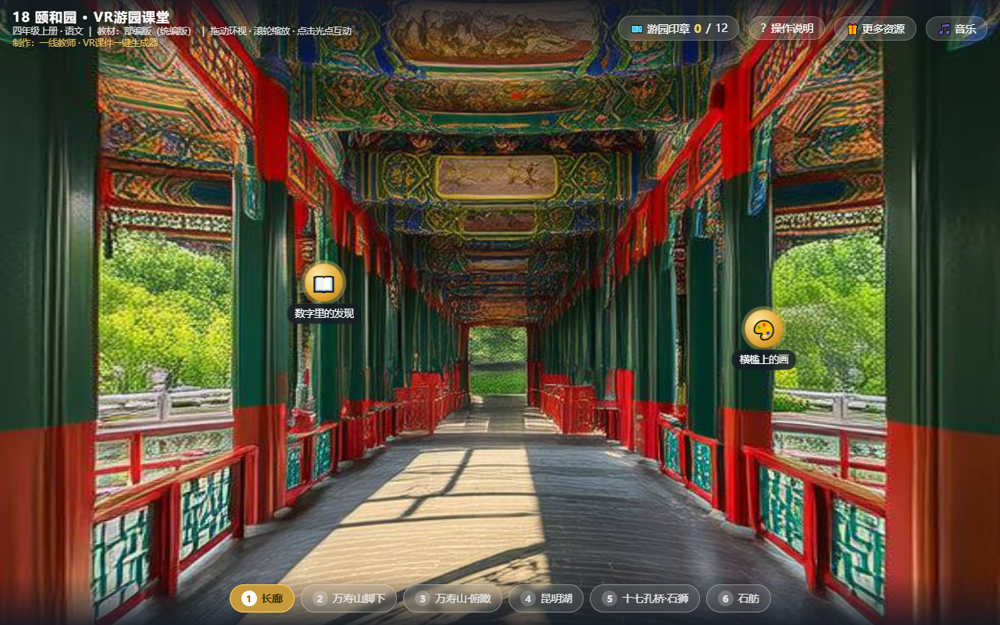
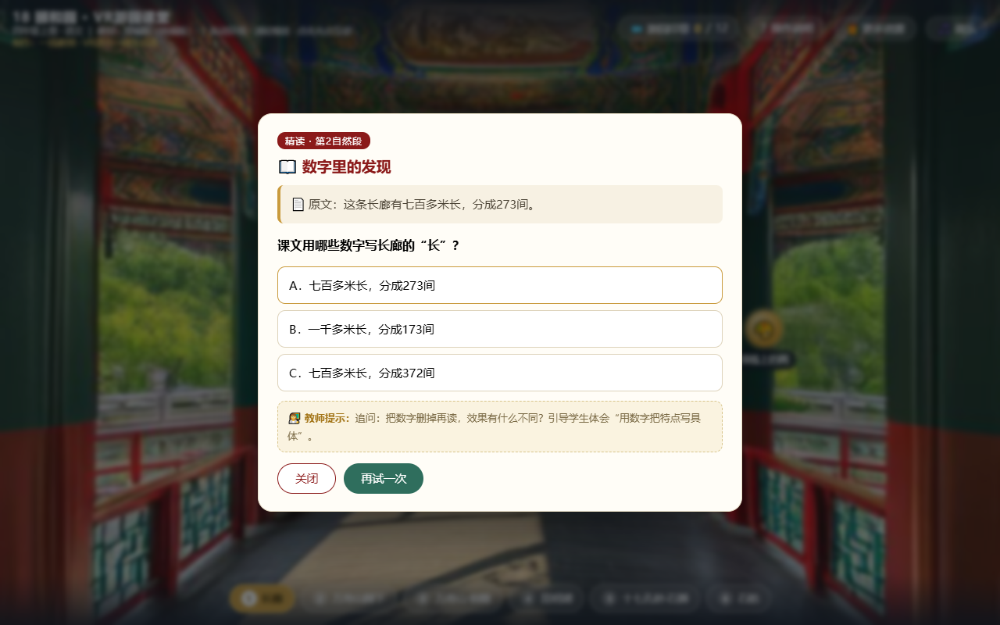

# 🥽 VR课件一键生成器

> 选教材 → 选学科 → 选课文 → **一键生成**「可拖拽环视」的 VR 互动教学课件
> 单文件 HTML · 可离线 · 双击即用 · 适用所有学科

把课文变成学生可以「走进去」的课堂：拖拽鼠标环视全景、滚轮拉近拉远、点击金色光点答题闯关、集章得徽章——整套课件是一个**单文件 HTML**，双击即用，可随意发给学生和家长，微信里打开也能互动。

---

## 📸 效果展示

### 1️⃣ 生成器界面（三步向导，零代码操作）

学段 → 学科 → 教材版本 → 课文，内置精选课文库，也支持自定义课题；场景数量、互动密度、互动类型、署名、音乐、二维码全部可视化配置。

### 2️⃣ 课件效果 · 全景场景（拖拽环视 + 滚轮缩放）

基于 Three.js 圆柱全景框架：按住鼠标左右拖动环视眼前美景，滚动滚轮镜头拉远拉近；底部 6 站路线任意跳转，场景切换带「缩放进入」沉浸感动画。

### 3️⃣ 课件效果 · 课堂互动（选择题 + 集章徽章）

每个场景预埋教学热点：选择题、比喻句配对、小导游任务——点开就是原文 + 提问 + 👩‍🏫 教师提示，答对得印章，集满出徽章。

---

## ✨ 功能特性

| 特性 | 说明 |
|---|---|
| 🖱️ 拖拽环视 | 按住鼠标/触屏拖动，阻尼惯性环视全景 |
| 🔍 滚轮缩放 | 镜头拉远拉近，细看每一处美景 |
| ✨ 课堂互动 | 选择题 / 比喻配对 / 小导游任务，带课文原句与教师提示 |
| 🎫 集章徽章 | 答对得印章，集满出徽章（localStorage 持久化） |
| 🗺️ 路线导航 | 底部站点任意跳转 + 画面边缘快捷箭头 |
| 🎬 缩放进入 | 场景切换「旧场景缩小淡出 → 新场景放大淡入」 |
| 🎵 背景音乐 | 音乐文件命名 `1.mp3` 与课件同目录即可播放 |
| 📦 单文件离线 | Three.js 与图片全部内嵌，不依赖网络 |
| 📱 触屏可用 | 手机/平板/大屏一体机均可 |

**四种配图方式**（按需选，无 Key 也能用）：

| 方式 | 说明 |
|---|---|
| 🖼️ 内置成品图 | 《颐和园》已内置 6 张真实场景图，零配置直接出真图课件 |
| 🤖 AI 一键生成 | 填阿里云百炼 API Key（sk- 开头），通义万相自动逐场景出图 |
| 📤 本地上传 | 自备 6 张横构图景点照片按场景上传 |
| 🎨 艺术占位图 | 零配置先出课件框架，课后可随时换真图 |

**内置课文库**：语文《颐和园》（四上·18课，12 个教学热点）、《观潮》（四上）、《记金华的双龙洞》（四下）、《美丽的小兴安岭》（三上）；英语《At the Zoo》（PEP 三下 Unit 3）。学科覆盖语文/英语/科学/地理/历史/通用自定义，学段覆盖小学/初中/高中。

---

## 🚀 快速开始（三选一）

### 方式 A：免安装 Windows EXE（推荐给不写代码的老师）

1. 下载 `VR课件一键生成器.exe`（约 12MB）
2. 双击运行 → 稍等 1-2 秒 → 浏览器自动打开生成器
3. 选课文 → 点「🎯 一键生成VR课件」→ 下载课件

> 不需要安装 WorkBuddy、Python 或任何软件；支持 Windows 10/11（64位）。
> 首次运行若被杀毒软件/SmartScreen 拦截，点「更多信息 → 仍要运行」即可（未签名软件正常现象）。
> 黑色命令行窗口是本地服务器，关掉它即停止服务；使用时保持开着即可，不用管。

### 方式 B：单文件 HTML 版

下载本仓库中的技能包 ZIP，解压后得到 `assets/VR课件一键生成器.html`，双击用 Chrome/Edge 打开即可（功能与 EXE 完全一致）。

### 方式 C：安装为 WorkBuddy 技能

1. 下载 `VR课件一键生成器-技能包-v1.0.zip` 并解压，得到「VR课件一键生成器」文件夹（含 `SKILL.md` 和 `assets`）
2. 把整个文件夹复制到本机技能目录：
   - Windows：`C:\Users\你的用户名\.workbuddy\skills\`
   - Mac/Linux：`~/.workbuddy/skills/`
3. 重启 WorkBuddy，技能列表出现「VR课件一键生成器」，随用随调；
   也可以在对话里直接说：「用 VR课件一键生成器 帮我把《XXX》做成 VR 课件」

---

## 📁 文件说明

| 文件 | 说明 |
|---|---|
| `VR课件一键生成器.exe` | 免安装 Windows 版（双击即用，约 12MB） |
| `VR课件一键生成器-技能包-v1.0.zip` | WorkBuddy 技能包（含 SKILL.md + 生成器 + 示例 + 说明） |
| `示例-颐和园VR互动课件.html` | 一键生成的成品示例（6 张真实场景图 + 12 个教学互动，可直接上课用） |
| `images/` | README 截图（生成器界面 / 全景场景 / 互动答题） |

---

## ❓ 常见问题

**Q1：没有 API Key 能生成吗？**
能。选「内置成品图」（颐和园）或「艺术占位图」，功能完全一样，只是场景图为占位样式。

**Q2：API Key 怎么申请？**
打开 [bailian.console.aliyun.com](https://bailian.console.aliyun.com) → 登录 → 右上角头像 → API-KEY 管理 → 创建（新用户有免费额度）。Key 只保存在你自己浏览器的本机存储，不上传任何服务器；本仓库发布版本不含任何密钥。

**Q3：想改课件里的题目/文字？**
用记事本或 VS Code 打开生成的 HTML，搜索题目标题直接改。

**Q4：想换成自己拍的照片？**
用「本上传」模式重新生成一次即可。

**Q5：支持几个场景？**
4 / 6 / 8 个场景任选；每场景 1-3 个教学热点；场景数与热点数都会实时反映在课件里。

**Q6：生成的课件学生怎么用？**
课件是单个 HTML 文件，微信发给他、双击打开就能拖拽环视、答题集章。

---

## 🛠️ 技术说明

- 课件框架：Three.js r128 圆柱全景（内联，离线可用）
- 场景图：阿里云百炼「通义万相」wanx2.1-t2i-turbo（1280×720 横构图）
- 打包：PyInstaller onefile（EXE 内嵌页面 + 本地服务 + 自动开浏览器）
- 生成器为纯前端单文件应用，图片 base64 内嵌，无任何后端依赖

⭐ 如果这个项目对你有帮助，欢迎 Star 分享给更多老师！
